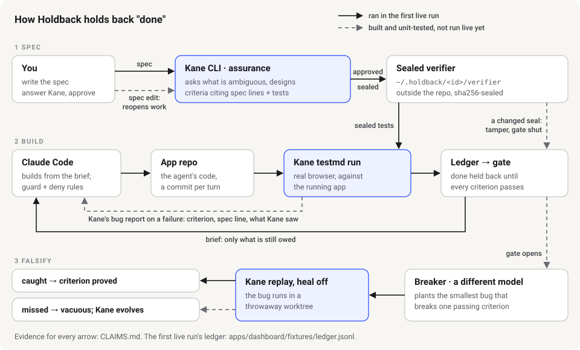

# Holdback

<!-- headline:start -->Holdback planted a bug against each of the 26 criteria Kane's tests passed on a real app. Kane's replays could judge 10 of them and caught 4, each on two replays; none of the 6 that got past them broke the criterion it was planted against (3 changed no behaviour, 3 broke a different rule). On the held-out 22-case exam the builds tied: Holdback's build, Claude Code alone and Claude Code with its own Kane checks each passed 22/22.<!-- headline:end -->

Holdback holds back a coding agent's "done" until Kane CLI proves every acceptance criterion of your spec in a real browser. You write only the spec. Kane designs the criteria and the tests, Claude Code builds from Kane's bug reports, and a criterion counts as proved only after Kane catches a bug planted to break it.

<!-- links:start -->[Landing page](https://holdback-seven.vercel.app) · [Demo video](https://youtu.be/U6Cx9BSI2O8) · [Dashboard replay](https://holdback-seven.vercel.app/replay/)<!-- links:end -->



Solid arrows ran live: in the first live run, the rehearsal or the pantry run below. Dashed arrows are built and covered by unit tests but have not run live yet. [CLAIMS.md](CLAIMS.md) gives the evidence for each.

## What it does

1. **You write the spec.** A `PRD.md` in your app's folder. It is the only thing you write.
2. **Kane designs the checks.** Kane CLI's assurance commands read the spec and ask you about what is ambiguous. Then they design acceptance criteria, each citing the spec line it comes from, and browser tests for them. You approve, and you give a value to every test variable Kane left empty (Holdback suggests one). Holdback keeps the tests in a verifier folder outside your repo (`~/.holdback/<id>/verifier/`) and seals them with sha256 hashes.
3. **The agent works only from bug reports.** Each turn, Claude Code gets a brief of the criteria still owed. When a Kane run fails, the brief carries Kane's bug report: the criterion, the spec line, the step Kane ran, what it saw, its diagnosis and a screenshot. It never carries the test file.
4. **"Done" is held back.** After every turn, Holdback starts the app and Kane runs the sealed tests in a real browser. The gate opens only when every criterion passes.
5. **A planted bug tests the tests.** For each passing criterion, a breaker on a different model writes the smallest patch that should break it, in a throwaway git worktree; a patch that changes no code is set aside unrun. Kane replays that criterion's tests with healing off. A bug Kane catches twice, blaming the app on that criterion, proves the criterion. One it misses counts only when a referee (a second, separate model call) names an input where it visibly breaks that criterion. Then the criterion is vacuous: Holdback tells Kane (never the agent) what slipped through, Kane evolves the use case's tests, and the next pass plants the same bug, which the new tests must catch.
6. **Spec edits reopen the work.** Edit the spec and Kane plans the change (`holdback drift`, or automatically in `run` and `watch`). You approve, and the new or changed criteria are owed again.
7. **Tampering fails closed.** If something Holdback sealed changes behind its back, the gate stays shut until you look and run `holdback reseal`. That covers the tests, the spec, the config, Kane's recordings, the ledger, and `.git/config` keys that make git run code.

A Kane run that fails for a reason other than the app (Kane's verdict blames its environment or its own automation, or the run timed out or crashed) is re-run once. If it still proves nothing, it is never sent to the agent and never counts as a catch; the gate stays shut and `holdback status` says why.

## Results

### The pantry run

One live run of Holdback on [`examples/pantry-spec/PRD.md`](examples/pantry-spec/PRD.md) (an eligibility check, visit booking and a volunteer list), 2026-11-16 to 18: Kane CLI 0.10.4, Claude Code on `opus`, breaker `deepseek-v4-flash` on Venice. Its sanitized ledger is the dashboard replay's fixture; `holdback status` or the replay reduces it.

<!-- demo:start -->
| Recorded demo run ([ledger](apps/dashboard/fixtures/ledger.jsonl)) | |
| --- | --- |
| Questions Kane asked about the spec | 2 |
| Acceptance criteria Kane designed | 57 |
| Browser tests Kane designed | 22 |
| Criteria left without a test (design cap) | 14 |
| Agent turns (Claude Code calls) | 9 |
| Kane bug reports that reached the agent | 7 |
| Criteria green after the first turn's check | 16 of 57 |
| Criteria green when the build stopped | 26 of 57 |
| Gate at the end | closed |
| Planted bugs Kane caught | 4 of 26 |
| Planted bugs that got past their criterion's tests | 6 (3 changed no behaviour, 3 broke a different rule) |
| Planted bugs whose replays proved nothing | 16 |
| Use cases Kane evolved after a surviving bug | 2 (1 more paused on Kane's own questions) |
| Tests Kane's evolves minted, retired | 5, 10 |
| Kane credits, by balance | 5233.9 |
| Agent cost | $6.37 |
| Claude Code minutes | 41.0 |
| Kane test-run minutes | 499.3 |
| Breaker cost | $0.0262 |
<!-- demo:end -->

- **Spec.** Kane asked 2 questions, then designed 57 criteria in 4 use cases, each citing its spec lines, and 22 tests. 14 criteria got no test: Kane designed the 6 scenarios per use case the config allowed.
- **Build.** Nine Claude Code turns took the app from 16 of 57 criteria green, at the first check, to 26, when the run stopped at its Kane credit cap. Along the way 9 Kane runs timed out. The 17 criteria still owed hung on the last runs of 7 tests: 6 blamed Kane's own automation (rows they expected earlier tests to leave, a visit time earlier tests had filled), and the seventh was a wrong report on the app, "Volunteer list link does not display the Volunteer list", first made against a plain `<a href="/volunteer">` link while Kane's own observation listed the volunteer page. The agent moved the link in turn 6; Kane kept reporting it. [FINDINGS.md](FINDINGS.md) 17 to 21.
- **Planted bugs.** With the gate still shut, `holdback run --max-turns 0` planted one bug against each of the 26 passing criteria, for $0.03 of breaker calls. Kane's replays could judge 10 of them.
  - **4 caught**, each again on a second replay, and those criteria proved: visit times starting a day late (ac-12), the "Choose a visit time." message dropped (ac-21), the "Book a visit" button disabled (ac-29), the household-size message emptied (ac-32).
  - **6 got past their criterion's tests, and none of them broke that criterion.** Three change no behaviour: m-ac-20-1 inlines the expression the variable it replaces already holds, m-ac-53-1 replaces a line with the same line, m-ac-36-1 sets a key the object sets again after it. Three break a different rule: m-ac-26-1 and m-ac-37-1 change only what a household with a benefit sees, outside ac-26 (households without one) and ac-37 (income-decided results, which still show their limit); m-ac-27-1 changes only an income of 0, which ac-27 (income above the limit) never meets.
  - **16 proved nothing**: 7 replays hit Kane's own automation trouble (5 times the replay selected the visit time after submitting the booking), 2 lost the app (connection refused), 4 failed a different criterion, 2 patches did not apply and 1 did not start.
- **Evolve.** Holdback took the 6 for misses. It had Kane evolve uc-2 and uc-3, each told the breaker's account of a bug that was not there; Kane minted 5 tests and retired 10. In uc-2 the follow-up evolve also covered 4 criteria the design cap had left without a test. uc-3's evolve replaced its 6 tests with one, and its follow-up paused on a question of Kane's, so 13 criteria that had a test lost it, the 2 it had proved among them. uc-1's evolve paused too: Kane asked whether one person earning $568 a week is "Eligible." as the published at-or-below rule says, or "Not eligible." as the breaker's account claimed, and noted that the reason was cut off. Kane was right on both counts. Holdback then cut the reason at 1,500 characters and took the pause for an error, so it rolled both back, and on this ledger uc-1's 4 criteria stay vacuous ([FINDINGS.md](FINDINGS.md) 20). Since this run, a no-op filter and a referee set such patches aside before Kane sees them, the reason is never cut mid-text, and a pause like uc-1's is Kane disputing the bug ([below](#planted-bugs-that-get-through)).

### The exam

<!-- results:start -->
| Arm | Exam passed | Inconclusive | Claimed done | Claude Code turns | Build credits | Agent cost | Breaker cost | Wall minutes |
| --- | --- | --- | --- | --- | --- | --- | --- | --- |
| A: Claude Code alone | 22/22 | 0 | yes | 18 | 0.0 | $0.71 | $0.00 | 3.0 |
| B: Claude Code + its own Kane checks | 22/22 | 0 | yes | 22 | 65.0 | $0.93 | $0.00 | 11.8 |
| C: Holdback | 22/22 | 0 | no | 218 | 5135.5 | $6.37 | $0.03 | 2268.2 |

Each finished app was scored once on the pre-registered 22-case exam in `eval/` (A 22/22, B 22/22, C 22/22); a case that failed for a reason other than the app counts as not passed.

- C: build credits and wall minutes count from its first build turn to its last ledger event, planted bugs included and stops between runs included; its spec stage is not in them (98.4 credits, 81.0 minutes).
<!-- results:end -->

The exam tied: this spec is within reach of Claude Code alone. A and B claimed done and were right, but nothing in either arm checked that their checks can fail (B's own Kane checks cost 65 credits and were never attacked). Holdback is the arm that tests its checks: its planted bugs proved 4 of Kane's criteria, and its ledger shows everything else they found, its own breaker's mistakes included. That cost far more: $6.37 of agent time, 5,135.5 Kane credits from the first build turn (98.4 more in the spec stage) and $0.03 of breaker, against $0.71 and no credits for A. C's 2,268.2 wall minutes are the 37.8 hours from its first build turn (Nov 16) to the end of falsify (Nov 18), across separate `holdback run`s with overnight stops between them. Its active time was 41.0 minutes of Claude Code turns and 499.3 minutes of Kane test runs, one at a time (the ledger's `turn.end` `durationMs` and each `run`'s `durationS`).

**The limit this run showed.** Holdback held "done" back from an app the exam found correct: Kane's own runs were too flaky for the gate to open, and every planted bug that got through was the breaker's mistake, not a weak Kane test. The pre-registered expectation ([eval/PREREGISTERED.md](eval/PREREGISTERED.md)) was half met: Holdback scored at least as high as A and B, but A and B did not stop with a failing case. The exam, its hashes and that expectation were committed before any arm was built.

## Who it is for

Developers who hand a feature to a coding agent and want "done" to mean the spec holds in a browser, checked by tests the agent can neither read nor edit. It fits apps with a browser UI and a written spec. It is not a unit-test runner.

An agent that writes its own tests also decides what passing means: the same reasoning wrote the code and the check, and the cheapest path to green is to bend the check. In Holdback, Kane designs the checks from the spec, they live outside the repo, the agent only sees what failed, and a proved criterion has survived a bug planted to break it.

## Quick start

Holdback is installed from source for now. Clone this repository, then:

```sh
pnpm i
pnpm -r build
cd packages/cli
npm link            # puts `holdback` on your PATH (`npm link ./packages/cli` from the root fails on the workspace dependency)
```

Then, in your app's folder (a git repository with a `PRD.md`):

```sh
holdback init       # writes holdback.config.json and the verifier folder
holdback spec       # Kane asks and designs, you approve and fill test variables, Holdback seals
holdback run        # Claude Code builds until every criterion passes, then planted bugs
```

`holdback status` shows every criterion and the gate at any time.

**Interactive mode.** `holdback init --agent claude` (after `holdback spec`) installs hooks and a skill in `.claude/`; then work in `claude` as usual. After every Edit or Write, Kane checks the app in the background and wakes the agent with a bug report when it finds a failure. Claude Code cannot stop while a criterion is owed; after 5 refused stops in a row it hands over to you. It also sets `permissions.blockReadsOutsideWorkingDirectories: true` in the project's `.claude/settings.json`, which keeps your own Claude Code sessions in this project inside it too. `holdback init --agent claude --remove` takes it all out.

**Scripted answers.** `spec`, `run`, `drift` and `watch` take `--answers <file>`, a JSON file outside the app folder: `{"answers": {"q1": "..."}, "default": "recommended", "approve": "all", "variables": {"primary_phone": "2155550101"}}`. `"default": "recommended"` takes Kane's recommended option for a question the file does not name, and Holdback's suggested value for a test variable it does not name (never for a secret). `spec`, `run` and `drift` also take `--dashboard`, which asks in the browser. An answers file never accepts a spec change of unverified origin: that takes a yes typed in the terminal.

**Before `holdback spec`.** The config is sealed with the spec, so set `holdback.config.json` first; for one command, use `--max-turns` and `--kane-cap`. If your app depends on the date or time, pin them in `start.env` (`{ "start": { "env": { "HOLDBACK_TODAY": "2026-11-19", "HOLDBACK_NOW": "08:00" } } }`) and have the app read them, as the pantry spec's stack notes ask, so every Kane run sees the same day.

**Your app's data.** Every time Holdback starts your app for Kane (a turn's checks, a re-run, the hooks' check, a planted bug, a bisect probe, the closing replay), it sets `DATA_DIR` to a new, empty folder under `~/.holdback/<id>/data/`, over `start.env`. Keep your app's state there, so a replay meets the same empty app. Tests in one batch share that start, so a test can still meet rows an earlier test wrote ([FINDINGS.md](FINDINGS.md) 18). The agent's own boot check gets a scratch `DATA_DIR` outside the repo. If your app writes a `data/` folder in the repo when you start it by hand, put it in `.gitignore`: falsify refuses a work tree with uncommitted changes.

## Requirements

- Node 24 or later, and pnpm 9 to build from source; git.
- Kane CLI 0.10.4 or later, logged in (`kane-cli login`), with credits (`kane-cli balance`).
- Claude Code (`claude` on your PATH, logged in).
- Optional: `VENICE_API_KEY` for the breaker. Without it, use `holdback run --no-falsify`.
- Your app starts with one command and listens on the port in the `PORT` environment variable.

Kane bills credits for designing and authoring tests: about 16 credits and 40 seconds per authored step in the first live run, 5,233.9 credits in all for the pantry run ([JUDGES.md](JUDGES.md#6-run-it-yourself)).

## Configuration

`holdback init` writes `holdback.config.json` in your app's folder. A key you leave out takes its default (`packages/core/src/project.ts`). The file is sealed: an edit by the agent is a tamper.

| Key | Default | What it does |
| --- | --- | --- |
| `spec` | `["PRD.md"]` | Spec files in the app folder that Kane reads. |
| `specUrls` | `[]` | Links Kane reads as spec sources. |
| `agentNotes` | unset | A stack and style notes file the agent's brief points to, e.g. `STACK.md`. |
| `start.cmd` | `"npm start"` | The command that starts your app, the one command Holdback runs through a shell. Kane, claude, git and taskkill run with no shell, found on PATH only. |
| `start.port` | `3100` | The port passed to the app in `PORT`. Holdback refuses a port another program already uses. |
| `start.readyPath` | `"/"` | The path polled until the app answers. |
| `start.env` | unset | Extra environment for the app, e.g. a pinned `HOLDBACK_TODAY` and `HOLDBACK_NOW`. `DATA_DIR` here is overridden. |
| `agent.kind` | `"claude"` | The coding agent. Claude Code is the only one. |
| `agent.model` | unset | Model passed to Claude Code (`--model`). |
| `agent.maxTurnsPerCall` | `60` | `--max-turns` for each Claude Code call. |
| `kane.parallel` | `3` | Kane tests run at once in the build checks. |
| `kane.timeoutS` | `120` | Kane's `--timeout`, which applies to each step. Holdback stops a whole run after this times its step count, plus 30 seconds. |
| `kane.capCredits` | `null` | The most Kane credits this project may spend, as measured on the ledger. No Kane batch and no agent turn starts once it is reached (exit 3). `--kane-cap` overrides it for one command. |
| `kane.designMax` | `5` | `kane-cli design tests --max`: the most scenarios per use case, one test each. Criteria left without a test say "no test designed (design cap N)" and are never proved. |
| `breaker.model` | `"deepseek-v4-flash"` | The breaker's model on the Venice API. |
| `breaker.capUsd` | `2` | The most the breaker may spend for this project, in USD, across runs. |
| `breaker.parallel` | `1` | Kane replays the falsify stage runs at once, apart from `kane.parallel` ([FINDINGS.md](FINDINGS.md) 13). |
| `loop.maxTurns` | `15` | The highest turn number. Turns are numbered across runs; `--max-turns` overrides it. |
| `loop.denyWeb` | unset | `true` takes WebFetch and WebSearch away from the agent. |
| `loop.appendClarifications` | `"always"` | Where your answers to Kane go: `"always"` appends them to `PRD.md`; `"spec-only"` only in the spec stage. |

| Environment variable | What it does |
| --- | --- |
| `VENICE_API_KEY` | The breaker's key. Holdback blanks it for the agent and the app. |
| `HOLDBACK_HOME` | Where verifier folders and ledgers live (default `~/.holdback`). The agent never gets it, nor any other `HOLDBACK_*` variable. |
| `HOLDBACK_KANE_BIN`, `HOLDBACK_CLAUDE_BIN` | The Kane CLI and Claude Code binaries: a `.js`/`.cjs`/`.mjs` script, an `.exe` or, on Windows, an npm `.cmd` shim, whose JS entry Holdback runs with Node and never through a shell. Default: on PATH. |
| `HOLDBACK_GUARD_LOG` | A file the guard hook appends each decision to, for debugging. |

## Commands

| Command | What it does | Exits |
| --- | --- | --- |
| `holdback init [--spec <file>] [--url <url>] [--start <cmd>] [--port <n>] [--force]` | Writes `holdback.config.json` and creates the verifier folder. | 0, 1 |
| `holdback init --agent claude [--remove]` | Installs (or removes) the Claude Code hooks and skill for interactive mode. | 0, 1 |
| `holdback spec [--answers <file> \| --dashboard] [--kane-cap <n>]` | Kane designs criteria and tests; you answer and approve (what you leave unticked is rejected); you give a value to each test variable Kane left empty, with Holdback's suggestion, a secret typed with echo off; Holdback repairs an `@import` Kane wrote as an absolute Windows path, then seals. It prints the gaps Kane left. A variable left empty stops it before the seal (exit 3); run it again for the rest. | 0, 1, 2, 3 |
| `holdback run [--max-turns <n>] [--no-falsify] [--answers <file> \| --dashboard] [--kane-cap <n>]` | Builds until Kane proves every criterion, then falsifies the passing ones, and builds again while falsify leaves criteria owed. When the gate cannot open (Kane's runs proved nothing, the loop stalled, or the turn limit was reached) it falsifies the passing criteria anyway and stops held back. `--max-turns 0` falsifies what Kane last saw pass, with no new turn and no new check. Runs drift first when the spec changed. | 0, 1, 2, 3, 130 |
| `holdback drift [--answers <file> \| --dashboard] [--kane-cap <n>]` | Applies a spec edit made after the last seal: shows the diff, Kane re-plans with you, empty test variables are asked for before the seal. | 0, 1, 2, 3 |
| `holdback watch [--max-turns <n>] [--no-falsify] [--answers <file>] [--kane-cap <n>]` | On every spec edit runs drift, then the run loop, until Ctrl-C. | 1, 2, 3, 130 |
| `holdback status [--json]` | The verdict `run` exits with, every criterion, the gate, why a criterion is vacuous or needs the spec, a stall's disputed reports, each evolve (tests minted and retired, never what Kane was told) and the retired tests. | 0, 1, 2 |
| `holdback owed` | What the coding agent is told is still owed. | 0, 1, 2 |
| `holdback reseal [--yes]` | Accepts the files on disk as the new sealed state, which lifts a tamper. It refuses when only the spec changed (that is drift). | 0, 1, 2, 3 |
| `holdback clean` | Removes leftover mutant and bisect worktrees. Never delete them by hand: they link into your app's `node_modules`. | 0, 1, 2 |
| `holdback serve [--port <n>] [--static <dir>]` | The local dashboard on 127.0.0.1 (default port 4317): ledger, gate, live events, and answering Kane from the browser. | 0, 1 |
| `holdback hook <guard\|post-edit\|stop\|prompt>` | The Claude Code hook entry point that `init --agent claude` installs. | hook protocol |

`spec`, `run`, `drift`, `watch`, `reseal`, `serve` and `init --agent claude --remove` refuse to run inside a Claude Code session, and the guard hook denies them, `init`, `clean` and `hook` in the agent's shell commands (by any path, behind `npx`, an env prefix, `cmd /c` or `powershell -c`). `status` and `owed` stay open to the agent.

| Exit code | Meaning |
| --- | --- |
| 0 | Success. For `run`: released, the gate open and every criterion proved or passing. |
| 1 | An error, or not finished (the turn limit was reached). |
| 2 | Tamper: something sealed changed. Nothing counts until you run `holdback reseal`. |
| 3 | Held back: criteria still owed, vacuous or without a test, Kane's runs proved nothing, or the loop stalled. Also: the spec changed (run `holdback drift`), the Kane credit cap was reached, or `holdback spec` stopped on an empty test variable. `run`, `status` and the dashboard read one verdict and never say "Released" unless `run` would exit 0. |
| 130 | Interrupted. One Ctrl-C stops after the current step; a second quits at once. |

### When the gate cannot open

Three stops end the build loop without the gate open. **Kane's own runs proved nothing**: a test that timed out or hit Kane's own trouble was re-run once and still proved nothing (exit 3). **The loop stalled**: two finished turns in a row changed nothing on the code Kane checked, with the app up, whatever is owed (`build.stalled`, exit 3); a turn that changes nothing is not checked again. `holdback run`, `status` and the dashboard then list Kane's reports the agent did not act on (disputed: if Kane's test is wrong, change the spec and `holdback drift`; if it is right, `holdback run` again) and the runs that proved nothing. **The turn limit** (exit 1). After any of the three, `holdback run` falsifies the passing criteria as it would with the gate open and says so: "falsified 26 passing criteria (4 proved, 4 vacuous, 0 skipped on budget)" in the pantry run. The verdict stays held back; a use case Kane evolves then is built by the next `holdback run`.

### Planted bugs that get through

A patch whose changed lines are the lines they replace (whitespace outside quotes aside), or that leaves a JavaScript, TypeScript, CSS or JSON file's tokens as they were, is invalid before any replay: "changes no code". When Kane's replay lets a planted bug through, a referee must confirm it: one more Venice call on the breaker's model, at temperature 0, with its own prompt, shown only the criterion, its spec quotes and the patch. It must name a concrete input, what the criterion says the page shows for it and what the mutant shows instead. If it names none, or the two are the same, the bug is invalid ("off target: …", "no observable change: …") and the criterion keeps its status. Its answer is on the ledger (`mutant.referee`), its cost under `breaker.capUsd`.

A confirmed survivor goes to Kane: Holdback runs `kane-cli maintain evolve <use case> --because "<what slipped through>"` in the verifier and answers Kane's own re-design question, nothing else. The reason is the referee's account of the bug in a user's terms, never cut: over 1,500 characters it carries fewer whole accounts and says how many it left out, and an account too long for Kane's command line is not sent at all (the survivor stays vacuous). You see it in `holdback run`, `holdback watch` and the dashboard, never in `holdback status`, which the agent may run. If the evolve pauses on a question of Kane's, Holdback does not answer it: Kane disputes the bug (`falsify.disputed`), nothing is retired or sealed, and the criterion keeps its status. `holdback run` and the dashboard list the bugs the referee rejected or Kane disputed, with the reason or Kane's question; `holdback status` names only the criterion and the bug, since Kane's question echoes what it was told. Otherwise Kane's new tests replace every test of the use case; Holdback seals them with Kane as their author (any other sealed file changed by the evolve is a tamper), and every criterion of the use case is owed again; the next pass plants the same bug, which must now be caught. A criterion the new set leaves without a test gets one follow-up evolve, then needs the spec. At most two evolves per use case per `holdback run`, under the credit cap.

### Spec changes

Editing the spec after the seal is drift, not a tamper: Kane re-plans the criteria with you (`holdback drift`, or `holdback run`, which runs it first). Holdback cannot tell who edited the spec, so it fails closed: a change counts as yours only when no agent turn has started since you last approved a spec change in the terminal or on the dashboard. Otherwise `run` stops, and `drift` and `watch` show you the diff and go ahead only on a yes typed in the terminal. The agent's Edit and Write of the spec are denied, and so are the shell writes the guard recognises; one on record makes a spec change a tamper.

## Honest limits

- The verifier is sealed, guarded and hashed, not sandboxed. The deny rules and the guard stop the reads they recognise; a shell read through a path built at run time gets past them, so the agent could read the hidden tests. The hashes detect a change after the fact; they never stop a read.
- Human-only commands are refused by an env check (`CLAUDECODE`) plus the guard's command rule; both are best-effort against an agent that disguises its shell commands.
- The referee is an LLM's judgment, not a proof: it can confirm a bug that changes nothing a user sees (one whose effect is undone outside the patch it reads) or reject a real one, which then proves nothing. The no-op filter catches only unchanged lines or tokens. In the pantry run, before both existed, all 6 survivors were such patches; the referee's prompt has been tried live on two patches only.
- Kane's evolve replaces every test of the use case. In the pantry run one evolve and a stopped follow-up took the test away from 13 criteria, so a stronger test for one criterion can cost coverage of others. A dispute (an evolve paused on Kane's question) sets aside every bug that evolve was told about and waits for a human to read the question.
- A gate held shut by Kane's own flaky runs holds back a correct app: the pantry run's app passed the exam 22/22 with "done" still held back.
- In interactive mode, Bash edits to git-ignored files are not noticed until the agent's next Edit or Write.
- Kane CLI is a cloud service: test runs, screenshots and the pages Kane saw are uploaded to LambdaTest Test Manager.
- Authoring is slow and billed per step, and a failing test re-authors on every run.
- Holdback has run live on Windows only, and on one spec family. Figures marked pending are not claimed yet.

[CLAIMS.md](CLAIMS.md) tags every public statement with its evidence and lists what is not claimed.

## For reviewers

- [JUDGES.md](JUDGES.md): a 5-minute path that needs no credentials, and how to run it yourself.
- [CLAIMS.md](CLAIMS.md): every claim, tagged with the file or script behind it.
- [FINDINGS.md](FINDINGS.md): what building on Kane CLI 0.10.4 taught us.
- [MOCKS.md](MOCKS.md): what is real and what is simulated.
- [eval/PREREGISTERED.md](eval/PREREGISTERED.md): the held-out exam; [eval/results/](eval/results/): its scores.

## Development

```sh
pnpm -r build        # every package, the dashboard (live and replay) and the landing page
pnpm -r test         # unit tests; no Kane, Claude Code or Venice calls
pnpm -r typecheck
pnpm render-readme   # fills the generated parts of README.md, JUDGES.md and CLAIMS.md
```

The dashboard's browser tests need Playwright's Chromium: run `npx playwright install chromium` in `apps/dashboard` on a fresh machine.

| Folder | What is in it |
| --- | --- |
| `packages/core` | The loop: Kane and Claude Code wrappers, ledger, gate, seal, guard, breaker, falsify, drift, bisect, local server. |
| `packages/cli` | The `holdback` command and the Claude Code hooks. |
| `apps/dashboard` | The dashboard: live (served by `holdback serve`) and a static replay of a recorded ledger (`fixtures/`: the pantry run). |
| `apps/site` | The landing page. |
| `eval` | The pre-registered exam, the arm runner, the scorer and the results. |
| `examples/pantry-spec` | The spec the exam and the pantry run are written against. |
| `examples/first-live-run` | The first live run's ledger, config and screenshots (the 4-rule spec). |

## License

[MIT](LICENSE)
